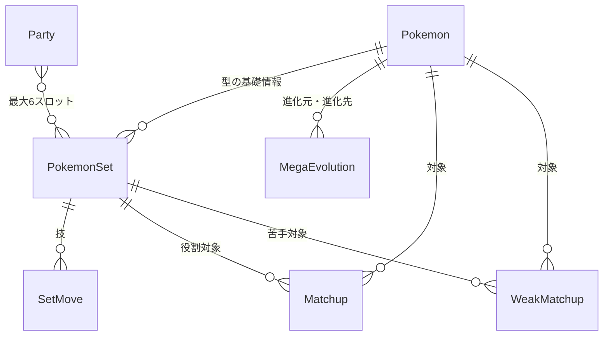

# pokemon-manager（ポケマネ）

対戦用のポケモンの型とパーティーを管理し、構築の相性や弱点を分析する非公式の個人開発Webアプリケーションです。

Python / Django を中心に、データベース設計、診断ロジック、JavaScriptによる動的UIを実装しました。

> 本リポジトリは学習成果・ポートフォリオの公開を目的としています。公式サービスではありません。第三者の画像や実データについては、後述の権利・公開方針を参照してください。

## 開発背景

対戦用の構築を考える際、個々の型や技構成、対応できる相手、苦手な相手を別々に管理すると、パーティー全体の弱点を把握しにくくなります。

そこで、型の情報を再利用しながらパーティーを組み立て、登録した情報から構築の穴やタイプ相性を可視化するツールを開発しました。単なるデータ管理ではなく、構築検討の意思決定を支援することが目的です。

## 主な機能

| 機能 | 内容 |
| --- | --- |
| ポケモンマスター管理 | 全国図鑑No、タイプ、種族値、体重、特性、仮想敵フラグなどの登録・編集・検索 |
| 型管理 | 特性、持ち物、性格補正、能力ポイント、技、メモの登録・編集・削除 |
| 能力値プレビュー | ポケモンや能力ポイントの変更に応じた実数値・残りポイントの表示 |
| 役割対象・苦手対象管理 | 対象ポケモンと遂行方法の登録、検索による候補の絞り込み、行の動的追加・削除 |
| パーティー管理 | 最大6枠への型登録、削除、隣接スロットとの交換、構築名・備考の管理 |
| メガ進化対応 | 進化先の分岐管理、メガ前後の表示・診断の切り替え |
| 構築バランス診断 | 得意・苦手な相手、構築の穴、仮想敵への対応、防御側タイプ一貫、攻撃技範囲の分析 |
| CSVインポート | ポケモンマスターとメガ進化関係の一括登録 |
| レスポンシブUI | PC・スマートフォンで利用できる画面レイアウト |

## 構築診断の仕組み

### 役割対象・苦手対象

型に登録された役割対象を、後出し可・対面処理・上から処理・削り前提・やや不安定などの遂行方法で分類します。

苦手対象についてはパーティー内での登録数を集計します。苦手として登録されている一方、役割対象として登録されていない相手を「構築の穴」として抽出します。

### 防御側タイプ一貫

各メンバーのタイプと登録された特性をもとに、攻撃タイプごとの被ダメージ倍率を判定します。

- 全メンバーに等倍以上で通るタイプ
- 全メンバーに抜群以上で通るタイプ
- 全メンバーに抜群以上ではないが、3体以上に抜群以上で通るタイプ（要注意）
- 地面・電気無効枠

無効・半減など、実装対象の特性による補正も考慮します。

### 攻撃技範囲

登録した攻撃技のタイプを集計し、単タイプ18種類に対して、等倍以上の技がないタイプと抜群以上の技がないタイプを判定します。変化技は攻撃範囲の集計対象から除きます。

### メガ進化

メガ進化前後のポケモンを別データとして管理し、進化先との関連付けを行います。パーティー編集画面ではメガ進化状態を一時的に切り替え、タイプ・特性・実数値などの表示と診断結果に反映します。

## 使用技術

| 分類 | 技術 |
| --- | --- |
| バックエンド | Python 3.14 / Django 6.0系 |
| フロントエンド | HTML / CSS / JavaScript（Vanilla JS） |
| データベース | SQLite（開発環境） |
| データアクセス | Django ORM |
| 非同期通信 | Fetch API / JSON |
| バージョン管理 | Git / GitHub |
| 開発環境 | VS Code / macOS |

## 設計・実装上の工夫

- **データの再利用**：ポケモンのマスター情報と個別の型を分離し、同じ型を複数のパーティーから利用できるようにしました。
- **責務の分離**：画面・保存処理と、能力値計算や診断ロジックを分け、機能追加時の変更範囲を抑える設計を採用しました。
- **動的な入力フォーム**：役割対象・苦手対象を必要な件数だけ追加・削除でき、行番号やフォーム項目を連動させています。
- **操作性の改善**：検索によるポケモン候補の絞り込み、アイコンプレビュー、能力値の即時表示を実装しました。
- **リアルタイム診断**：Fetch APIを用いて診断結果を更新し、メガ進化状態の切り替えにも対応しています。
- **構築順序の保持**：スロット削除時に自動で左詰めせず、利用者が指定した順序を保持します。必要に応じて隣接スロットを交換できます。
- **拡張性**：体重や特性、メガ進化関係を管理できるデータ構造を採用し、将来のダメージ計算機能を見据えています。

## データモデルの概要



上図は概念モデルです。パーティーは実装上、6個のスロットに型を割り当てる方式を採用しています。

## ディレクトリ構成（主要部分）

```text
pokemon-manager/
├── manage.py
├── pokemane/
│   ├── models.py
│   ├── views.py
│   ├── urls.py
│   ├── admin.py
│   ├── services/           # 能力値計算・診断等
│   ├── management/
│   │   └── commands/       # CSVインポート
│   ├── migrations/
│   ├── templates/pokemane/
│   └── static/pokemane/
│       ├── css/
│       └── js/
└── README.md
```

## ローカル環境での起動

Python 3.14、Gitを用意してください。以下はmacOSでの実行例です。

```bash
# リポジトリをcloneしたディレクトリで実行
python3 -m venv venv
source venv/bin/activate
python -m pip install -r requirements.txt
python manage.py migrate
python manage.py createsuperuser
python manage.py check
python manage.py runserver
```

Windows PowerShellで仮想環境を有効化する場合：

```powershell
py -m venv venv
.\venv\Scripts\Activate.ps1
```

起動後、ブラウザで以下のURLにアクセスします。

| URL | 画面 |
| --- | --- |
| http://127.0.0.1:8000/pokemon/ | ポケモン一覧 |
| http://127.0.0.1:8000/sets/ | 型一覧 |
| http://127.0.0.1:8000/parties/ | パーティー一覧 |
| http://127.0.0.1:8000/admin/ | Django管理画面 |

公開版には個人利用時のDBや第三者素材を同梱しない方針です。マイグレーション後は、管理画面または登録画面から必要なデータを登録してください。CSVを利用する場合は、利用・再配布が許可されたデータを用意し、インポートコマンドの仕様に従ってください。

```bash
python manage.py import_pokemon_csv --help
python manage.py import_mega_evolutions_csv --help
```

## 今後の開発予定

- 認証機能の整備とユーザー単位のデータ分離・権限制御
- 型・パーティーの閲覧用詳細画面と編集画面の分離
- 構築記事形式のパーティー詳細画面
- 公開・非公開設定、公開データの検索、いいね機能
- 技マスターデータベースとダメージ計算機能
- 自動テストの拡充、PostgreSQLへの移行、本番運用設定

## 開発状況

型管理・パーティー管理・構築診断を中心とするMVPを開発しています。本番向けのマルチユーザー対応や公開サービスとしての運用は今後の課題です。

## 権利・公開方針

本プロジェクトは個人の学習・技術検証を目的とした非公式のプロジェクトであり、株式会社ポケモン、任天堂株式会社、株式会社クリーチャーズ、株式会社ゲームフリークその他の権利者による公式サービス、承認済みサービスではありません。

ポケモン関連の名称、キャラクター、画像、商標等に関する権利は、それぞれの権利者に帰属します。本プロジェクトは第三者の知的財産に対する権利や利用許諾を主張するものではありません。

公開対象は自作のアプリケーションコードおよび公開可能な資料・データに限定する方針です。第三者の画像、ロゴ、利用条件が確認できていないデータ、個人利用のデータベースは公開対象外とします。

第三者の素材やデータを利用する場合は、各権利者の利用条件を確認し、必要な許諾を得てください。

参考：

- [ポケットモンスターオフィシャルサイト ご利用について](https://www.pokemon.co.jp/rules/)
- [Pokémon.com 権利表記について](https://www.pokemon.com/jp/legal/information)
- [Pokémon Support — Can I use Pokémon images or materials?](https://support.pokemon.com/hc/en-us/articles/360000634094-Can-I-use-Pok%C3%A9mon-images-or-materials)

## ライセンス

本リポジトリの自作コードについて、現時点ではオープンソースライセンスによる包括的な再利用許諾を付与していません。別途ライセンスを明示した部分および第三者の依存ライブラリ等については、それぞれのライセンスに従います。

